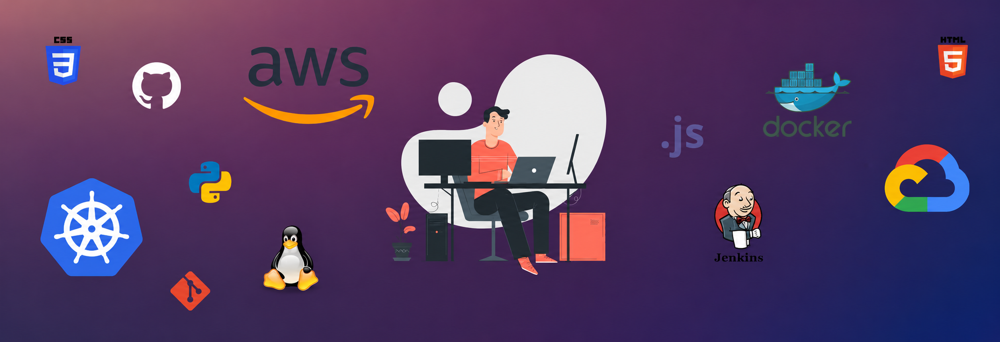

  

<h1 align="center">Hi 👋, I'm Archana</h1>

<h3 align="center">DevOps Engineer | AWS | CI/CD | Cloud Infrastructure</h3>

  

  Building reliable infrastructure and automating deployments.

  

---

### 👩‍💻 About Me

- 🚀 Interested in Cloud Computing and DevOps Engineering.
- ☁️ Working with AWS cloud services and infrastructure.
- 🔧 Learning and implementing CI/CD automation.
- 🐳 Exploring Docker and Kubernetes.
- 🌱 Continuously improving my Linux, Bash and Terraform skills.
- 🎯 Passionate about automation, scalability and reliable deployments.

---

### 🛠️ Technical Skills

**Cloud & Infrastructure**

**CI/CD & DevOps**

**Operating Systems & Tools**

---

### 🚀 Featured Projects

- 🔹 CI/CD Pipeline Automation using Jenkins
- 🔹 AWS Infrastructure Provisioning using Terraform
- 🔹 Dockerized Application Deployment
- 🔹 Kubernetes Application Deployment

*Project links will be added as repositories become available.*

---

### 📊 GitHub Statistics

  
  

---

### 🤝 Connect With Me

  
  

⭐ Thanks for visiting my profile!
